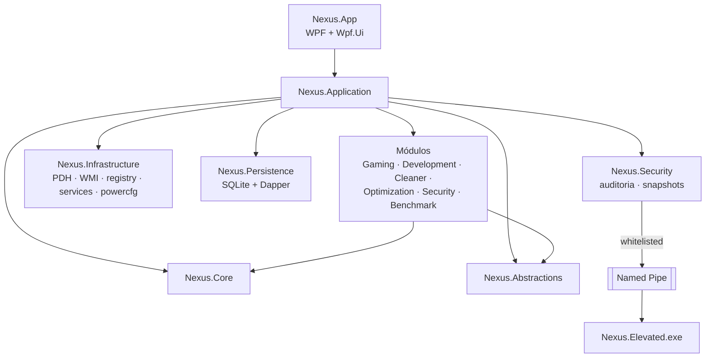
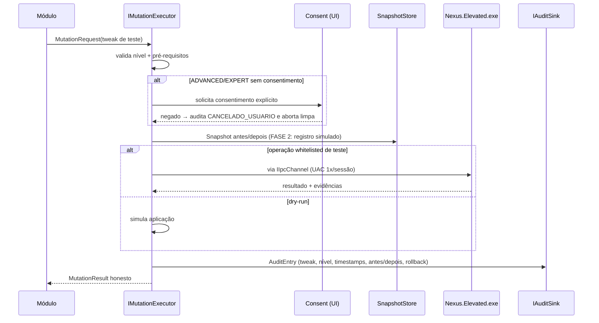

# Spec: nexus-optimizer — Design (FASE 2, Fundação)

**Estado: 📝 Planejado**

Documento de design da fundação técnica. Aprofunda a arquitetura aprovada em [docs/ARCHITECTURE.md](../../../docs/ARCHITECTURE.md) apenas no necessário para construir a FASE 2 sem ambiguidade.

## 1. Visão geral

Solução `Nexus.slnx` com 15 projetos em `src/`, seguindo dependência unidirecional: App → Application → Core; módulos → Abstractions/Core; tudo que é SO real → Infrastructure; elevação → Elevated (processo separado). Host único compose em `Nexus.App`.



Regra de fronteira: `Nexus.Infrastructure` é o **único** projeto que referencia APIs de SO (PDH, WMI, registry, services). `Nexus.Core`/`Nexus.Application`/`Nexus.Abstractions` compilam e testam sem tocar Windows (interfaces de ambiente injetadas) — enforcement por teste de arquitetura (Req 8.2).

## 2. Contratos-chave (Nexus.Abstractions)

```csharp
public readonly record struct SensorReading<T>(
    bool IsAvailable,
    T? Value,
    string Source,
    DateTimeOffset Timestamp,
    string? UnavailableReason);

public interface ISensorSource {
    string Name { get; }                 // "PDH", "WMI", "NvAPI", "LHM"
    Task<SensorReading<T>> ReadAsync<T>(SensorKey key, CancellationToken ct);
}

public interface IMutationExecutor {
    Task<MutationResult> ExecuteAsync(MutationRequest request, CancellationToken ct);
}
public sealed record MutationRequest(
    string TweakId, RiskLevel Level, IReadOnlyDictionary<string, string> Parameters,
    bool ConsentGranted = false);
public sealed record MutationResult(
    MutationStatus Status,               // Applied | DryRun | Failed | CancelledByUser | Rejected
    string? RollbackRef, string? AuditId, string? FailureReason);

public interface IAuditSink {
    Task RecordAsync(AuditEntry entry, CancellationToken ct);
}

public interface IIpcChannel {
    Task<ElevatedResponse> SendAsync(ElevatedRequest request, CancellationToken ct);
}
```

Decisões de contrato:

- `SensorReading<T>` é `readonly record struct` — barato para telemetria de 1 s; `T?` com `IsAvailable` impede valor falso por construção de uso.
- `IMutationExecutor` retorna `MutationResult` (nunca lança exceção de negócio) — a UI sempre consegue renderizar resultado honesto.
- `IIpcChannel` tipado: `ElevatedRequest` = nome de operação + `Parameters` validados — inexistência de campo "command": **por design não existe shell livre**.

## 3. Fluxo do portão de mutação (FASE 2 = dry-run)



## 4. Persistência (FASE 2)

- Arquivo: `%LocalAppData%\Nexus\nexus.db` (SQLite, `Microsoft.Data.Sqlite`).
- Migrações: array ordenado de scripts SQL em código; controle por `PRAGMA user_version`; aplicação transacional (falha → rollback + abort limpo).
- Repositórios Dapper por tabela de docs/ARCHITECTURE.md §6. FASE 2 exerce `settings` + `mutations` (dry-run) + `restore_points` (metadado).

## 5. IPC e helper elevado (FASE 2)

- Named pipe: `nexus.elevated.<sid>`; ACL concede apenas o usuário atual; helper valida identidade do processo cliente antes de executar.
- Whitelist FASE 2 (compilada): **1 operação de teste** (ex.: `TEST_ECHO_ELEVATED`) — prova o canal sem executar mutação real.
- Lifecycle: spawn sob demanda (UAC 1x/sessão) → ocioso > N s → encerra. UAC negado → `CancelledByUser` sem estado parcial.
- Payload rejeitado (não whitelisted / formato inválido) → log + `Rejected`; helper **nunca** devolve exceção crua pela pipe.

## 6. Shell WPF (FASE 2)

- `App.xaml` compõe `IHost`; `MainWindow` (Wpf.Ui `NavigationView`) com 9 itens de docs/UI_UX.md §3; páginas placeholder com selo "📝 Planejado — ver ROADMAP".
- Detecção de elevação no startup: `WindowsIdentity` → banner/aviso (Req 5.1).
- ViewModels com `CommunityToolkit.Mvvm` source generators (`ObservableProperty`, `RelayCommand`).

## 7. Teste de arquitetura (enforcement)

Teste que carrega os assemblies e falha se:

1. `Nexus.Core`, `Nexus.Application`, `Nexus.Abstractions` referenciarem `Microsoft.Win32.Registry`, `System.Management`, tipos de serviço ou P/Invoke fora de `Nexus.Infrastructure`/`Nexus.Elevated`.
2. Módulos referenciarem módulos (exceto via Abstractions/Core).
3. `Nexus.App` referenciar `Nexus.Elevated` (comunicação é só via pipe).

## 8. Riscos e mitigações (FASE 2)

| Risco | Mitigação |
|---|---|
| Slnx/projeto com 15 csproj vira burocracia | Criar via script `scripts/new-solution.ps1` idempotente, versionado |
| Single-file + WPF quebrando em publish | Validar `dotnet publish` já na FASE 2 com o shell (pipeline de empacotamento cedo) |
| Whitelist de teste abrir precedente perigoso | Operação de teste sem efeito colateral + revisão obrigatória para adicionar qualquer outra |
| Teste de arquitetura frágil | Falhar com mensagem explícita do arquivo/tipo infrator, não heurística opaca |
