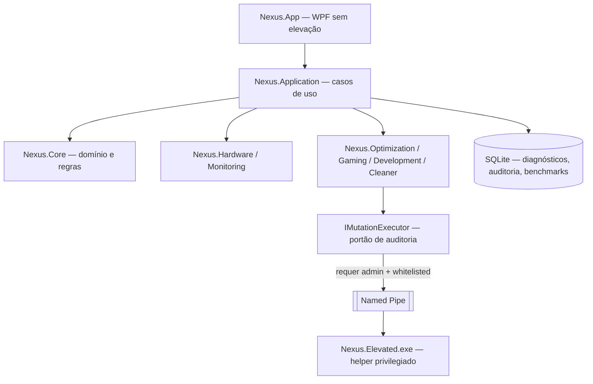

# NEXUS OPTIMIZER

> Seu Windows 11 rodando do jeito que deveria: rápido, limpo e medido de verdade — sem mágica, sem promessa vazia.
>
> **CONTROL YOUR SYSTEM. UNLOCK YOUR PERFORMANCE.**
> **KNOWLEDGE IS MEANT TO BE SHARED.**

> Construído com conhecimento compartilhado, colaboração e respeito pela comunidade de tecnologia. Projeto independente, **sem fins lucrativos**, feito para ajudar pessoas a entender, otimizar e aproveitar melhor seus computadores. Veja [docs/PHILOSOPHY.md](docs/PHILOSOPHY.md).

---

## O que é o NEXUS (explicando direito)

Todo mundo já viu aqueles programas de "otimizar PC" que prometem deixar a máquina turbinada, mostram uma barrinha bonita... e no fim ninguém sabe o que eles realmente fizeram. Alguns até quebram o Windows.

O **NEXUS OPTIMIZER** nasceu para ser o oposto disso: um aplicativo para Windows 11 que mantém seu PC saudável de forma **transparente**. Ele mostra o que está acontecendo na sua máquina, sugere melhorias explicando **o porquê** de cada uma, aplica com segurança, **mede o resultado de verdade** e, se algo não ajudar, desfaz com um clique.

Ele não é teoria: nasceu de uma otimização real feita à mão num PC de uso diário (31/10/2026), com resultados medidos:

| O que foi feito na mão | Resultado real |
|---|---|
| Limpeza seletiva de disco (caches, temporários, componentes antigos do Windows) | **51,3 GB liberados** no SSD |
| Remoção de 15 programas "fantasmas" da lista de instalados (com backup individual de cada um) | 15/15 corretos, zero erro |
| Ajustes para jogos (energia, captura em segundo plano, rede) | Aplicados **com script completo para desfazer tudo** |
| Reparo dos medidores de desempenho do Windows, que estavam quebrados | Causa-raiz encontrada e corrigida |

O NEXUS transforma esse trabalho, que hoje exige um técnico experiente, em um app que qualquer pessoa consegue usar com segurança.

## Para quem é

- **Quem joga competitivo** (ex.: PUBG): menos travadinhas, tempo de quadro estável e o PC focado no jogo — sem gambiarras perigosas.
- **Quem programa e usa IA local**: VS Code, Python, Node, Docker, Ollama/Qwen3 no mesmo Windows sem o PC engasgar.
- **Quem só quer um PC rápido e confiável**: você não precisa entender de registro ou serviços — o app explica tudo em português claro.

## O que ele faz por você

| Módulo | Em linguagem simples |
|---|---|
| **Painel** | Como está a saúde do seu PC, em uma olhada |
| **Monitor** | CPU, placa de vídeo, memória, disco e rede em tempo real, com gráficos |
| **Gaming** | Deixa o PC pronto pra jogar: energia máxima, menos coisas roubando desempenho |
| **Modo Dev** | Organiza o ambiente de programação e ajusta IA local ao seu hardware |
| **Limpeza** | Remove lixo de verdade (caches, temporários) — mostra antes **o que e quanto** vai apagar |
| **Guardian** | Gerente de recursos inteligente: vê o que está aberto e pesado (inclusive IAs locais), prepara o PC antes do jogo e devolve tudo depois — sempre pedindo sua autorização |
| **Ajustes do Windows** | Catálogo de melhorias com explicação, nível de risco e caminho de volta |
| **Segurança & Restauração** | Pontos de restauração, histórico de tudo que o app mudou e botão de desfazer |
| **Laboratório de Medições** | Mede o PC antes e depois, em condições iguais, e diz com honestidade se melhorou |

> Tudo isso está **planejado e documentado** — o app ainda não foi programado. O status honesto de cada item está em [docs/ROADMAP.md](docs/ROADMAP.md).

## Os 5 compromissos (não negociamos)

1. **Número falso, nunca.** Se um medidor não funciona, o app diz "indisponível" e por quê — nunca inventa valor.
2. **Tudo tem volta.** Antes de mudar qualquer coisa, o app guarda o estado anterior. Desfazer é um clique.
3. **Zero promessa de FPS.** Melhoria se prova medindo; se não melhorou, o próprio app sugere desfazer.
4. **Ele não mexe no que não deve**: antivírus do Windows, Windows Update, Firewall, anti-cheat de jogos e ajustes de BIOS/overclock ficam intocados.
5. **Sem exigir "administrador" o tempo todo.** O app roda normal; só pede permissão elevada para o estritamente necessário, um item por vez.

## Stack tecnológica (para quem é da área)

| Camada | Escolha |
|---|---|
| Linguagem / runtime | C# 13 sobre **.NET 10 LTS** |
| UI | **WPF** + [`Wpf.Ui`](https://github.com/lepoco/wpfui) (Fluent) |
| MVVM | CommunityToolkit.Mvvm |
| Gráficos | LiveCharts2 |
| DI / Hosting | Microsoft.Extensions.Hosting |
| Logging | Serilog (rolling file, 100% local) |
| Persistência | SQLite (Microsoft.Data.Sqlite + Dapper) |
| GPU | NvAPIWrapper (sem admin) |
| Temperaturas (opcional) | LibreHardwareMonitorLib como **plugin isolado** |
| Instalador | Inno Setup, single-file self-contained `win-x64` |
| Operações elevadas | `Nexus.Elevated.exe` — helper com whitelist + named pipe |

Privacidade não é um detalhe: **nenhum dado sai do seu PC** — sem telemetria, sem analytics, sem nuvem.

## Arquitetura (visão rápida)

Detalhes em [docs/ARCHITECTURE.md](docs/ARCHITECTURE.md).

## Documentação

| Documento | Conteúdo |
|---|---|
| [docs/PRODUCT_VISION.md](docs/PRODUCT_VISION.md) | Visão do produto e objetivos |
| [docs/ARCHITECTURE.md](docs/ARCHITECTURE.md) | Arquitetura técnica e módulos |
| [docs/REQUIREMENTS.md](docs/REQUIREMENTS.md) | Requisitos funcionais e não funcionais |
| [docs/SECURITY.md](docs/SECURITY.md) | Segurança, permissões, auditoria, reversibilidade |
| [docs/ROADMAP.md](docs/ROADMAP.md) | Fases de desenvolvimento e prioridades |
| [docs/DECISIONS.md](docs/DECISIONS.md) | Decisões técnicas e justificativas |
| [docs/UI_UX.md](docs/UI_UX.md) | Identidade visual e experiência |
| [docs/GAMING_OPTIMIZATION.md](docs/GAMING_OPTIMIZATION.md) | Módulo Gaming / perfil PUBG |
| [docs/DEVELOPMENT_MODE.md](docs/DEVELOPMENT_MODE.md) | Módulo Development/IA |
| [docs/HARDWARE_MONITORING.md](docs/HARDWARE_MONITORING.md) | Monitoramento e diagnóstico |
| [docs/BENCHMARK.md](docs/BENCHMARK.md) | Estratégia de medição |
| [docs/RESOURCE_GUARDIAN.md](docs/RESOURCE_GUARDIAN.md) | Resource Guardian: gerência de processos, IA local e Pre-Flight de jogo |
| [docs/PHILOSOPHY.md](docs/PHILOSOPHY.md) | Filosofia, política não comercial e avaliação de licença |

## Comunidade e contribuição

Este projeto acredita que **conhecimento deve ser compartilhado** — e que iniciante não é carga, é futuro colaborador. Toda contribuição conta: código, documentação, tradução, revisão de texto, relato de bug bem escrito ou só uma boa ideia.

| Documento | Conteúdo |
|---|---|
| [CONTRIBUTING.md](CONTRIBUTING.md) | Como contribuir (por nível — de iniciante sem código a avançado) |
| [CODE_OF_CONDUCT.md](CODE_OF_CONDUCT.md) | Regras de convivência (resumindo: respeito, e "pergunta boba" não existe) |
| [SUPPORT.md](SUPPORT.md) | Onde pedir ajuda |
| [.github/SECURITY.md](.github/SECURITY.md) | Como reportar vulnerabilidades (em privado, nunca em issue pública) |

## Colaboradores

- **[@lucao019](https://github.com/lucao019)** — criador e mantenedor; caso real de origem (FASE 0) e decisões de produto.

Toda contribuição relevante (código, docs, testes, tradução, relatos, sugestões) é reconhecida aqui — conforme [docs/PHILOSOPHY.md §9](docs/PHILOSOPHY.md).

## Status de desenvolvimento

> **Fase atual: documentação e preparação do repositório (FASE 1 concluída).**
> Próxima fase: scaffold da solução .NET (FASE 2) — aguardando início.

| Estado | Significado |
|---|---|
| 📝 Planejado | Especificado e documentado, sem código |
| 🚧 Em desenvolvimento | Código em andamento |
| ✅ Implementado | Código pronto, sem validação |
| 🧪 Testado | Com testes automatizados |
| ✔️ Validado | Medido em máquina real |

Hoje: **tudo 📝 Planejado.** Quando mudar, este arquivo muda junto.

## Instalação (futura)

Quando a primeira build existir, a instalação será via Inno Setup (`installer/`). Não há build publicada ainda — este repositório contém planejamento e documentação.

## Desenvolvimento

Pré-requisitos (quando o código existir):

- Windows 11
- SDK **.NET 10** (máquina de referência: SDK 10.0.401 confirmado)
- Git

O contexto permanente para sessões do Kiro está em [.kiro/](.kiro/).

## Licença

**Em avaliação** — a proposta técnica (MIT, com comparação a Apache-2.0 e GPLv3) está documentada em [docs/PHILOSOPHY.md §6](docs/PHILOSOPHY.md) e aguarda aprovação do mantenedor. Nenhuma licença será adicionada arbitrariamente.

---

> Se alguém aprender programação estudando este código, já existe um resultado positivo.
> **Não estamos construindo conhecimento para guardá-lo. Estamos construindo para compartilhá-lo.**
