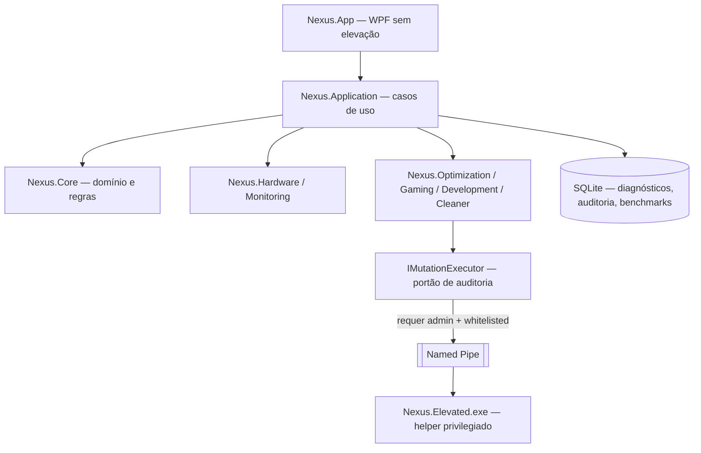

# NEXUS OPTIMIZER

> Plataforma profissional de otimização do Windows 11 para gaming competitivo, desenvolvimento de software, monitoramento de hardware, manutenção do sistema e engenharia de desempenho.

---

## O que é o NEXUS

O NEXUS OPTIMIZER é um aplicativo desktop para Windows 11 que une, em um único painel profissional:

- **Diagnóstico real de sistema** — hardware, software, serviços, integridade.
- **Monitoramento contínuo** — CPU, GPU, RAM, disco, rede, temperaturas.
- **Otimização guiada e auditável** — cada alteração é medida, registrada e reversível.
- **Perfis de uso** — Gaming competitivo (PERFIL A) e Desenvolvimento/IA (PERFIL B).
- **Benchmarks honestos** — antes/depois em condições controladas, sem promessas vazias.
- **Limpeza segura** — sem "cleaners genéricos", sem deleções cegas.

Ele nasceu de uma engenharia de otimização real feita manualmente em uma máquina de produção (limpeza de 51 GB, remoção de 15 órfãos de registro com backup individual, correção de contadores de desempenho corrompidos e tuning de gaming validado). O aplicativo transforma essa metodologia em produto.

## Princípios inegociáveis

1. **Nunca inventar métricas.** Se um sensor não está disponível, a UI mostra "indisponível" — nunca um valor falso.
2. **Tudo é reversível.** Toda mutação exige snapshot/backup antes de aplicar e gera entrada de auditoria.
3. **Sem promessas de FPS.** Otimizações são justificadas tecnicamente e validadas por medição; se não houver ganho mensurável, reverte.
4. **Não tocar em**: Defender, Windows Update, Firewall, anti-cheat de jogos, BIOS, overclock/undervolt do usuário.
5. **Sem admin por padrão.** O app principal roda sem elevação; operações privilegiadas passam por um helper separado com whitelist.

## Principais módulos (planejado)

| Módulo | O que faz |
|---|---|
| **Dashboard** | Visão geral: saúde do sistema, alertas, ações recomendadas |
| **System Monitor** | CPU/GPU/RAM/disco/rede/temperaturas em tempo real com gráficos |
| **Gaming Optimizer** | Perfil competitivo PUBG: anti-stutter, frametime estável, latência de entrada |
| **Development Mode** | Otimização do ambiente dev: Kiro, VS Code, Python, Node, Git, Ollama/Qwen3, Docker |
| **System Cleaner** | Limpeza seletiva de caches/temps/lixeira/WinSxS — com classificação de risco |
| **Windows Tweaks** | Catálogo de ajustes SAFE / ADVANCED / EXPERT, cada um com justificativa e rollback |
| **Security & Restore** | Pontos de restauração, catálogo de backups, auditoria e rollback centralizados |
| **Benchmark Lab** | Medição antes/depois com condições controladas e relatórios comparativos |

Todas as funcionalidades acima estão **planejadas** — nada está implementado ainda. Status real de cada item em [docs/ROADMAP.md](docs/ROADMAP.md).

## Stack tecnológica

| Camada | Escolha |
|---|---|
| Linguagem / runtime | C# 13 sobre **.NET 10 LTS** |
| UI | **WPF** + [`Wpf.Ui`](https://github.com/lepoco/wpfui) (Fluent) |
| MVVM | CommunityToolkit.Mvvm |
| Gráficos | LiveCharts2 |
| DI / Hosting | Microsoft.Extensions.Hosting |
| Logging | Serilog (rolling file) |
| Persistência | SQLite (Microsoft.Data.Sqlite + Dapper) |
| GPU | NvAPIWrapper (sem admin, sem driver kernel) |
| Temperaturas (opcional) | LibreHardwareMonitorLib como **plugin isolado** (exige admin) |
| Instalador | Inno Setup, publicação single-file self-contained `win-x64` |
| Operações elevadas | `Nexus.Elevated.exe` — helper separado com whitelist + named pipe |

Racional completo em [docs/DECISIONS.md](docs/DECISIONS.md) e [docs/ARCHITECTURE.md](docs/ARCHITECTURE.md).

## Arquitetura (visão rápida)

Detalhes em [docs/ARCHITECTURE.md](docs/ARCHITECTURE.md).

## Documentação

| Documento | Conteúdo |
|---|---|
| [docs/PRODUCT_VISION.md](docs/PRODUCT_VISION.md) | Visão do produto e objetivos |
| [docs/ARCHITECTURE.md](docs/ARCHITECTURE.md) | Arquitetura técnica e módulos |
| [docs/REQUIREMENTS.md](docs/REQUIREMENTS.md) | Requisitos funcionais e não funcionais |
| [docs/SECURITY.md](docs/SECURITY.md) | Segurança, permissões, auditoria, reversibilidade |
| [docs/ROADMAP.md](docs/ROADMAP.md) | Fases de desenvolvimento e prioridades |
| [docs/DECISIONS.md](docs/DECISIONS.md) | Decisões técnicas e justificativas |
| [docs/UI_UX.md](docs/UI_UX.md) | Identidade visual e experiência |
| [docs/GAMING_OPTIMIZATION.md](docs/GAMING_OPTIMIZATION.md) | Módulo Gaming / perfil PUBG |
| [docs/DEVELOPMENT_MODE.md](docs/DEVELOPMENT_MODE.md) | Módulo Development/IA |
| [docs/HARDWARE_MONITORING.md](docs/HARDWARE_MONITORING.md) | Monitoramento e diagnóstico |
| [docs/BENCHMARK.md](docs/BENCHMARK.md) | Estratégia de medição |

## Status de desenvolvimento

> **Fase atual: documentação e preparação do repositório (FASE 1 concluída).**
> Próxima fase: scaffold da solução .NET (FASE 2) — aguardando início.

| Estado | Significado |
|---|---|
| 📝 Planejado | Especificado e documentado, sem código |
| 🚧 Em desenvolvimento | Código em andamento |
| ✅ Implementado | Código pronto, sem validação |
| 🧪 Testado | Com testes automatizados |
| ✔️ Validado | Medido em máquina real |

Hoje: **tudo 📝 Planejado.**

## Instalação (futura)

Quando a primeira build existir, a instalação será via Inno Setup (`installer/`). Não há build publicada ainda — este repositório contém apenas planejamento e documentação.

## Desenvolvimento

Pré-requisitos (quando o código existir):

- Windows 11
- SDK **.NET 10** (máquina de referência: SDK 10.0.401 confirmado)
- Git

O contexto permanente para sessões do Kiro está em [.kiro/](.kiro/).

## Licença

A definir. Repositório **privado** até decisão contrária.
