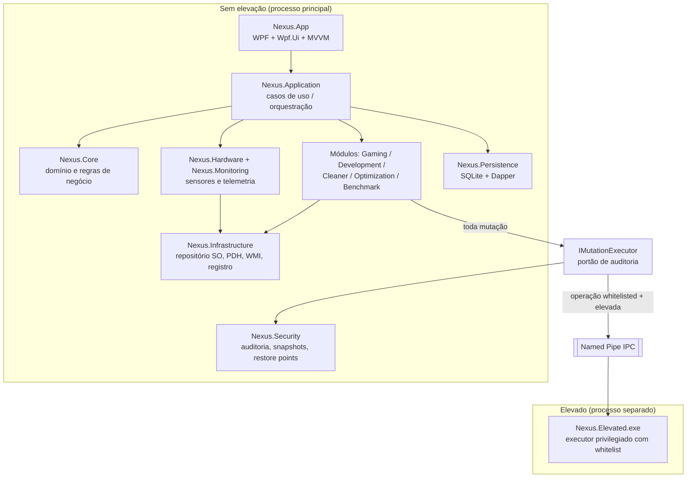
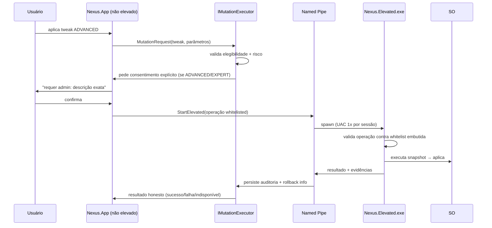

# ARCHITECTURE — NEXUS OPTIMIZER

**Estado: 📝 Planejado (FASE 1 aprovada, FASE 2 pendente)**

## 1. Visão geral

Desktop WPF modular, executando **sem elevação por padrão**, sobre .NET 10 LTS. Operações privilegiadas são delegadas a um processo helper separado (`Nexus.Elevated.exe`) via named pipe, restrito por **whitelist de operações** e registrado em auditoria.



## 2. Decisão de plataforma

| Item | Escolha | Motivo principal |
|---|---|---|
| UI framework | **WPF + Wpf.Ui** | Maturidade, ecossistema, empacotamento simples, controles Fluent sem casar com WinAppSDK |
| Rejeitado | WinUI 3 | Dependência WinAppSDK, empacotamento MSIX complica single-file e helper elevado |
| MVVM | CommunityToolkit.Mvvm | Source generators, padrão da comunidade |
| Gráficos | LiveCharts2 | Performance com dados em tempo real |
| Host/DI | Microsoft.Extensions.Hosting | DI, configuração, logging padronizados |
| Logs | Serilog rolling file | Auditoria técnica e debug em campo |
| Banco | SQLite + Dapper | Local, sem servidor, queries explícitas |
| Instalador | Inno Setup | Leve, universal, bom suporte a upgrade/remoção |
| Publicação | single-file self-contained `win-x64` | Usuário final não precisa do SDK |

## 3. Módulos e responsabilidades

| Projeto | Responsabilidade |
|---|---|
| **Nexus.App** | WPF shell: navegação, Views, ViewModels, theming |
| **Nexus.Abstractions** | Interfaces estáveis (`ISensorSource`, `IMutationExecutor`, `IAuditSink`, `IIpcChannel`...) |
| **Nexus.Core** | Entidades de domínio: diagnóstico, perfil, tweak, benchmark, regras de elegibilidade |
| **Nexus.Application** | Casos de uso/orquestração; nenhuma chamada direta de SO que o domínio possa fazer |
| **Nexus.Infrastructure** | Implementações: PDH, WMI/CIM, registry, services, powercfg, fsutil, DISM wrappers |
| **Nexus.Hardware** | Modelo de hardware; inventário (CPU/mobo/RAM/GPU/discos/rede/BIOS) |
| **Nexus.Monitoring** | Amostragem contínua, agregação, histórico para gráficos |
| **Nexus.Gaming** | Perfil Gaming, presets PUBG, verificações anti-stutter |
| **Nexus.Development** | Perfil Dev/IA: detecção de ferramentas (Kiro, VS Code, Python, Node, Git, Ollama, Docker), otimizações de ambiente |
| **Nexus.Cleaner** | Limpeza seletiva com classificação de risco e simulação (dry-run) |
| **Nexus.Optimization** | Catálogo de tweaks SAFE/ADVANCED/EXPERT + dependências entre tweaks |
| **Nexus.Security** | Pontos de restauração, backups por operação, log de auditoria, rollback |
| **Nexus.Benchmark** | Sessões de medição, comparação antes/depois, critérios de significância |
| **Nexus.Persistence** | Schema SQLite, migrações, repositórios Dapper |
| **Nexus.Elevated** | EXE helper privilegiado (ver §5) |

Dependência permitida: módulos dependem de **Abstractions/Core**, nunca uns dos outros diretamente (acoplamento via Application).

## 4. Princípio de honestidade de dados (arquitetural)

Todo sensor/métrica passa por um envelope:

```csharp
public readonly record struct SensorReading<T>(
    bool IsAvailable,        // sensor existe e respondeu?
    T? Value,                // nunca preenchido com placeholder falso
    string Source,           // "PDH", "WMI", "NvAPI", "LHM"...
    DateTimeOffset Timestamp,
    string? UnavailableReason);
```

Regras rígidas:

- Se `IsAvailable == false`, a UI **exibe "indisponível"** com o motivo; nunca 0, nunca último valor como se fosse atual, nunca valor simulado.
- Descoberta de contadores PDH **não pode assumir idioma**: enumerar via `ListSet`/padrões, com fallback WMI, e reportar falha como indisponível (lição: arquivos `perfc016.dat` ausentes derrubam contadores em pt-BR inteiro).
- Telemetria NUNCA bloqueia a UI (coleta em background, cache com timestamp).

## 5. Modelo de elevação



Regras:

- Whitelist de operações é **compilada no helper**, não configurável em runtime.
- Payload é nome de operação + parâmetros validados, nunca comando livre/shell.
- Helper encerra ao ficar ocioso; não fica residente.
- Se o usuário negar o UAC: operação aborta limpa, sem estado parcial.

## 6. Persistência (SQLite)

Tabelas previstas:

| Tabela | Conteúdo |
|---|---|
| `diagnostics` | snapshots periódicos de hardware/software |
| `sensor_samples` | séries temporais de monitoramento (com retenção) |
| `mutations` | auditoria: o quê, quando, antes/depois, como reverter |
| `restore_points` | pontos de restauração criados/referenciados |
| `benchmark_runs` | sessões de medição e resultados |
| `registry_backups` | caminhos dos .reg exportados por operação |
| `settings` | configurações do app |

Migrações versionadas no código (`PRAGMA user_version`).

## 7. Logging e auditoria

- **Serilog**: rolling file em `%LocalAppData%\Nexus\logs`, retenção configurável.
- **Auditoria de mutações** é separada do log técnico: vive em SQLite, é consultável na UI (Security & Restore) e exportável.
- Nenhum log contém dados pessoais além do necessário à operação; nenhum envio externo (sem telemetria de saída).

## 8. Estrutura de testes

- `tests/Nexus.Core.Tests` — regras de domínio (puras).
- `tests/Nexus.Application.Tests` — casos de uso com infra falsa.
- `tests/Nexus.Optimization.Tests` — elegibilidade/dependência de tweaks.
- `tests/Nexus.Benchmark.Tests` — estatística de comparação.
- Regra: lógica de domínio não pode depender de SO real (interfaces de ambiente injetadas).

## 9. Empacotamento

```text
publish/                (saída local, ignorada no git)
installer/
  nexus.iss             (script Inno Setup)
  output/               (ignorado no git)
```

`dotnet publish -c Release -r win-x64 --self-contained -p:PublishSingleFile=true` → `NexusSetup-x.y.z.exe`.

## 10. Máquina de referência (desenvolvimento/validação)

Ryzen 5 5600X (6C/12T), Gigabyte B550M AORUS ELITE (BIOS F14), 16 GB DDR4-3200 (XMP ativo), RTX 2060 6 GB (driver v621.01), SSD SATA 240 GB (C:) + HDDs WD 2 TB/1 TB, Windows 11 build 26200 pt-BR, monitor 1080p60. Observações:

- pt-BR = campo de prova real para o problema de contadores localizados.
- Overclock do usuário já configurado — **o app nunca o altera** (somente leitura informativa).
