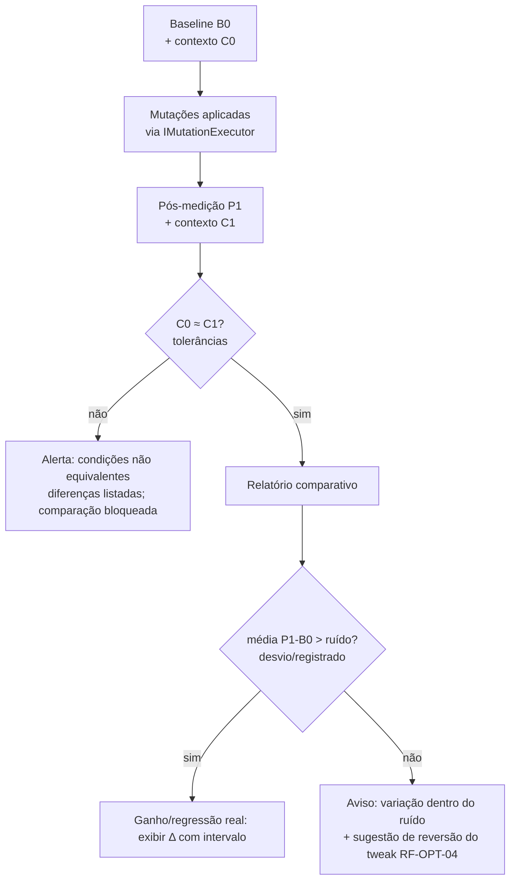

# BENCHMARK — Benchmark Lab

**Estado: 📝 Planejado**

Módulo de medição honesta (RF-BEN). Sua função é responder, com dados reais: **"a mudança fez diferença mensurável?"** — e dizer "variação dentro do ruído" quando não fez (RF-BEN-03).

## 1. Filosofia de medição

- **Condições equivalentes ou não há comparação** (RF-BEN-02): uptime, carga de processos, estado térmico e perfil ativo são registrados em cada execução; se divergirem além de tolerância, o app alerta e não compara.
- **Múltiplas amostras, não um número**: cada métrica é medida em série; relatório exibe média **e desvio**.
- **Sem promessa a priori**: o Benchmark mede; não estima ganho antes de medir (RF-GAME-03).
- **Honestidade herdada**: qualquer sensor indisponível invalida a métrica correspondente na comparação — nunca é preenchida por aproximação.

## 2. Baseline (RF-BEN-01)

Capturado **antes de qualquer mudança** e versionado na tabela `benchmark_runs`:

| Métrica | Descrição | Fonte |
|---|---|---|
| Boot time | Evento 100 do Microsoft-Windows-Diagnostics-Performance | log de eventos |
| CPU em repouso | uso % médio e por núcleo, janela de 60 s ocioso | Monitoring (PDH/NvAPI) |
| Disco em repouso | % tempo ativo, fila média | Monitoring |
| GPU em repouso | uso, clock, VRAM | NvAPI |
| RAM em repouso | uso, commit, disponível | Monitoring |
| Contexto | uptime, processos ativos, temperatura (se disponível), plano de energia, perfil NEXUS ativo | diagnóstico |

## 3. Protocolo de comparação antes/depois

Tolerâncias de contexto (fase planejada, ajustáveis): uptime dentro de faixa combinada, CPU idle de referência próxima, sem processos pesados novos, delta térmico pequeno.

## 4. O que mede (e o que não mede)

| Mede (fase 1) | Não mede (explícito) |
|---|---|
| CPU/disco/RAM/GPU em repouso e sob carga sintética leve | FPS dentro de jogo (não há captura de frametime em kernel/hooks — fase futura e fora do anti-cheat) |
| Tempo de boot (evento 100) | Benchmarks sintéticos agressivos de 3D |
| Impacto de tweaks do catálogo | Overclock/undervolt — domínio do usuário |

## 5. Integração com os módulos

- **Gaming/Optimization**: após aplicar um lote, o app oferece "medir agora" e agenda pós-medição com checklist de condições ("deixe o PC em repouso 60 s", "mesmo tempo desde o boot").
- **Reversão orientada por dado**: tweak sem ganho mensurável → entrada no relatório + sugestão de rollback com um clique (RF-OPT-04).
- **Perfil anotado**: toda execução registra se veio do perfil Gaming, Dev ou neutro.

## 6. Relatório (RF-BEN-03)

Formato exibido na UI e exportável:

| Seção | Conteúdo |
|---|---|
| Contexto | tabela C0 vs C1 com tolerâncias e status |
| Métricas | B0 vs P1, Δ absoluto e %, desvio de cada série |
| Veredito | por métrica: melhora / regressão / **dentro do ruído** |
| Ações | botões de reversão por tweak sem ganho |

Texto canônico quando não há significância: *"A variação observada está dentro do ruído de medição desta máquina. Não há evidência de ganho — considere reverter o ajuste."*

## 7. Regras de qualidade estatística (fase planejada)

1. Mínimo de N amostras por métrica (N alvo: 30 em 60 s de janela) antes de qualquer veredito.
2. Desvio padrão exibido sempre ao lado da média.
3. Sessões com `IsAvailable == false` em métrica → métrica marcada "sem dado" na comparação, sem interpolação.
4. Execuções interferidas (carga inesperada, térmico fora da faixa) podem ser descartadas com motivo registrado — descarte sempre visível na UI.

## 8. Critérios de aceitação

1. Baseline e pós-medição completam ponta a ponta na máquina de referência sem admin.
2. Comparativo bloqueia corretamente quando condições divergem (teste induzido).
3. Tweak placebo de teste é classificado "dentro do ruído" e recebe sugestão de reversão.
4. Nenhum número do relatório vem de fonte simulada ou interpolada.
