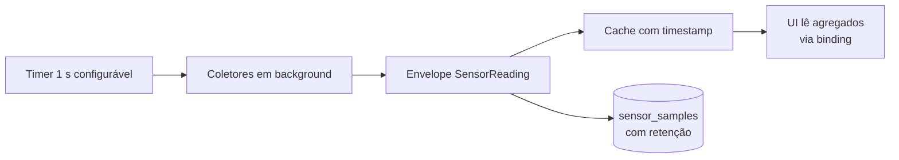

# HARDWARE MONITORING — Diagnóstico e Monitoramento

**Estado: 📝 Planejado**

Cobre os requisitos RF-DIAG (diagnóstico) e RF-MON (monitoramento contínuo). É a fundação de dados de todos os outros módulos: **nenhum módulo sugere sem medir**, e toda medição respeita o envelope `SensorReading<T>` (ADR-005).

## 1. Envelope de leitura (contrato central)

```csharp
public readonly record struct SensorReading<T>(
    bool IsAvailable,        // sensor existe e respondeu?
    T? Value,                // nunca preenchido com placeholder falso
    string Source,           // "PDH", "WMI", "NvAPI", "LHM"...
    DateTimeOffset Timestamp,
    string? UnavailableReason);
```

Regras rígidas (RNF-02, aceitação global 2):

- `IsAvailable == false` → UI exibe **"indisponível"** com o motivo e, quando aplicável, orientação de reparo.
- Nunca exibir 0, último valor congelado ou simulado como se fosse atual.
- Falhas de fonte são enriquecidas com contexto técnico (ex.: "contadores PDH corrompidos — catálogo pt-BR ausente").

## 2. Fontes de dados por métrica

| Métrica | Fonte primária | Fallback | Admin? |
|---|---|---|---|
| CPU total / por núcleo | PDH (`Processor Information`) | WMI `Win32_PerfFormattedData_PerfOS_Processor` | não |
| RAM (uso, disponível, commit) | PDH `Memory` | WMI `Win32_OperatingSystem` | não |
| Disco (% tempo, fila, throughput) | PDH `PhysicalDisk` | WMI `Win32_PerfFormattedData_PerfDisk_PhysicalDisk` | não |
| Rede (throughput, erros) | PDH `Network Interface` | WMI | não |
| GPU uso / clock / VRAM | **NvAPIWrapper** (user-mode) | PDH `GPU Engine`/`GPU Process Memory` | não |
| GPU/CPU temperatura | **LibreHardwareMonitorLib** (plugin isolado) | — | **sim** (driver kernel) |
| Boot time | Evento 100 (Diagnostics-Performance) | WMI `LastBootUpTime` | não para leitura de log de eventos do próprio usuário em escopo limitado |

### 2.1 Descoberta independente de idioma (RNF-10, ADR-006)

Lição do incidente real: contadores localizados pt-BR dependem de `perfcXXX.dat`/`perfhXXX.dat`; quando ausentes, o catálogo inteiro morre — inclusive consultas em inglês — **sem fallback automático**.

Regras de implementação:

1. Enumerar conjuntos/instâncias via API de enumeração (equivalente a `Get-Counter -ListSet`) com **padrões**, nunca strings fixas de idioma ("Processador" vs "Processor").
2. Mapear IDs de contador quando possível (PDH é indexado — o nome é cosmético).
3. Falha de descoberta → sensor indisponível com motivo; nunca lançar exceção para UI.
4. Diagnóstico de integridade (RF-DIAG-04) verifica explicitamente: Perflib 009/016, presença de `perfcXXX.dat`/`perfhXXX.dat` por idioma instalado, classes WMI de desempenho compiladas.

## 3. Inventário de diagnóstico (RF-DIAG-01/02)

| Categoria | Dados | Fontes |
|---|---|---|
| CPU | modelo, núcleos/threads, clocks base/boost, OC detectado (somente leitura) | WMI `Win32_Processor`, Ryzen Master-intel (futuro) |
| Placa-mãe / BIOS | fabricante, modelo, versão BIOS | WMI `Win32_BaseBoard`, `Win32_BIOS` |
| RAM | módulos, canais, frequência, XMP ativo | WMI `Win32_PhysicalMemory`, SMBIOS |
| GPU | modelo, driver, VRAM | NvAPI + WMI `Win32_VideoController` |
| Discos | modelo, interface, SMART (leitura), TRIM | WMI/Storage, `fsutil behavior query DisableDeleteNotify` |
| Rede | adaptadores, driver, power saving | WMI, PNP |
| Windows | build, edição, idioma(s) instalados | WMI/registry |
| Segurança/virtuação | VBS, HVCI, Credential Guard, Game Mode, HAGS | `DeviceGuard` WMI, GameConfigStore, registry |
| Energia | plano ativo e disponíveis | `powercfg /getactivescheme` |

Tudo com timestamp e persistido na tabela `diagnostics` para comparação histórica (RF-DIAG-06).

## 4. Entradas de boot (RF-DIAG-03)

Escopo: Run keys (HKCU + HKLM 32/64), Startup folders, tarefas agendadas com gatilho de logon.

Classificação por entrada:

| Classe | Critério |
|---|---|
| `seguro remover do boot` | assinatura válida + recurso não crítico + alternativa sob demanda (ex.: launchers de loja de jogos) |
| `candidato` | impacto mensurável estimado + não essencial à sessão |
| `risco / essencial` | driver, áudio, segurança, serviço de sincronização em uso |

**Regra:** selo de classificação é informativo; remoção/desativação é sempre item a item, com auditoria e rollback (estado anterior preservado). Nada é removido — no máximo **desabilitado** na fase inicial.

## 5. Hives de uninstall e órfãos (RF-DIAG-05)

Varredura das 3 hives (`HKLM\...\Uninstall` 64-bit, `HKLM\...\WOW6432Node\Uninstall`, `HKCU\...\Uninstall`) com classificação `SISTEMA` / `MSI` / `OK` / `ATENCAO` / `ORFAO_PROVAVEL` segundo os critérios múltiplos de [SECURITY.md](SECURITY.md) §4 (pontuação ≥ 2,5, export `.reg` individual antes de qualquer remoção, confirmação por item/lote).

Resultado histórico de validação dos critérios: 15/15 removidas na máquina de origem, 0 falsos positivos.

## 6. Loop de amostragem (RF-MON-01/04)



- Intervalo padrão 1 s, configurável; leituras em thread pool, **UI nunca bloqueia** (RF-MON-04).
- Amostragem pausa com janela minimizada (economia) — configurável.
- Séries persistidas com retenção limitada; downsampling para histórico longo.
- Alvo de RAM do app: < 300 MB em repouso (RNF-04).

## 7. Plugin de temperatura (RF-MON-02)

- LibreHardwareMonitorLib vive em **assembly isolado e opcional**; ausência do plugin ou falta de admin → temperaturas "indisponíveis" com motivo, resto do monitor funciona.
- O app nunca instala driver de kernel por conta própria: ativação do plugin é decisão explícita do usuário.
- Máquina de referência opera normalmente **sem** o plugin (NvAPI cobre GPU sem admin).

## 8. Cenário de contingência: contadores corrompidos

Fluxo obrigatório (aceitação global 2):

1. Diagnóstico detecta integridade quebrada (RF-DIAG-04).
2. Painel exibe banner: telemetria danificada + resumo técnico da causa (ex.: `perfc016.dat` ausente).
3. Módulos dependentes mostram sensores afetados como indisponíveis.
4. Guia de reparo referencia a cadeia real validada no incidente: restaurar arquivos de catálogo (DISM/SFC) → `lodctr /R` (System32 + SysWOW64) → `winmgmt /resyncperf` → `wmiadap /f`, com reteste.
5. **Nunca** exibir números fabricados enquanto durar a falha.
