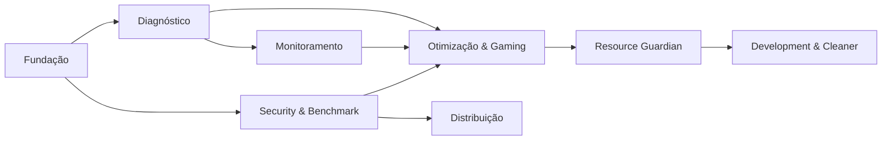

# ROADMAP — NEXUS OPTIMIZER

**Estado atual: FASE 1 concluída (documentação). FASE 2 aguardando início.**

Legenda de status de cada item: 📝 Planejado · 🚧 Em desenvolvimento · ✅ Implementado · 🧪 Testado · ✔️ Validado (medido em máquina real).

## FASE 0 — Caso real (origem) ✔️

Sessão manual de engenharia em máquina de produção (2026-10-31) que originou o produto: limpeza seletiva (C: de 0,3 GB → 51,3 GB livres), remoção de 15 órfãos de uninstall com backup individual, tuning de gaming com script de reversão, diagnóstico e reparo de contadores de desempenho corrompidos. Resultados verificados — viraram regras de produto.

## FASE 1 — Documentação e repositório ✔️

| Item | Status |
|---|---|
| Documentos de produto (visão, arquitetura, requisitos, segurança, decisões) | ✔️ |
| Documentos de módulos (Gaming, Development, Hardware/Monitoring, Benchmark, UI/UX) | ✔️ |
| Estrutura do repositório (src/, tests/, docs/, scripts/, assets/, installer/, .kiro/) | ✔️ |
| `.gitignore` completo (.NET/VS/Windows/segredos/dados privados) | ✔️ |
| Repositório git inicializado com commits convencionais | ✔️ |
| Contexto Kiro (.kiro/steering + .kiro/specs) | ✔️ |
| Publicação do repositório (público — ADR-016) | ✔️ |
| Filosofia e comunidade (PHILOSOPHY, CONTRIBUTING, CODE_OF_CONDUCT, SUPPORT, templates) | ✔️ |

## FASE 2 — Fundação técnica 📝

> Nenhuma funcionalidade de usuário. Só a espinha dorsal que as próximas fases exigem.

| Item | Entregável | Status |
|---|---|---|
| Scaffold da solução .NET 10 | `Nexus.slnx` + projetos do ARCHITECTURE.md §3 | 📝 |
| Host/DI/logging | Microsoft.Extensions.Hosting + Serilog rolling file | 📝 |
| `SensorReading<T>` + contratos | Nexus.Abstractions estável | 📝 |
| Persistência | SQLite + Dapper + migrações `PRAGMA user_version` | 📝 |
| Shell WPF | Navegação Wpf.Ui + theming, placeholder de módulos | 📝 |
| `IMutationExecutor` + auditoria | Portão único em modo dry-run (sem mutação real ainda) | 📝 |
| `Nexus.Elevated.exe` + IPC | Named pipe + whitelist compilada (1 opção de teste) | 📝 |
| Testes base | Core/Application com infra falsa | 📝 |

**Critério de saída:** app abre sem elevação, navega entre módulos vazios, loga, persiste settings, e o pipeline mutação→helper→auditoria funciona com uma operação de teste.

## FASE 3 — Diagnóstico (RF-DIAG) 📝

| Item | Status |
|---|---|
| RF-DIAG-01 Inventário de hardware/software | 📝 |
| RF-DIAG-02 VBS/HVCI/GameMode/HAGS/plano de energia | 📝 |
| RF-DIAG-03 Análise e classificação de boot | 📝 |
| RF-DIAG-04 Integridade de telemetria (PDH/WMI/perflib, independente de idioma) | 📝 |
| RF-DIAG-05 Varredura das 3 hives com classificação SISTEMA/MSI/OK/ATENCAO/ORFAO_PROVAVEL | 📝 |
| RF-DIAG-06 Persistência histórica de diagnósticos | 📝 |

**Critério de saída:** tela Diagnóstico exibe inventário real da máquina de referência; contadores quebrados → "indisponível" + orientação (critério de aceitação global 2).

## FASE 4 — Monitoramento (RF-MON) 📝

| Item | Status |
|---|---|
| RF-MON-01 Amostragem 1 s (CPU total/núcleo, GPU via NvAPI, RAM, disco, rede) | 📝 |
| RF-MON-02 Temperaturas via plugin LHM opcional | 📝 |
| RF-MON-03 Envelope `SensorReading<T>` em 100% das leituras | 📝 |
| RF-MON-04 Gráficos LiveCharts2 sem bloquear UI | 📝 |

**Critério de saída:** dashboard em tempo real na máquina de referência (RTX 2060 via NvAPI, sem admin); sensores ausentes exibem "indisponível".

## FASE 5 — Segurança & Restore + Benchmark (RF-SEC, RF-BEN) 📝

| Item | Status |
|---|---|
| RF-SEC-01 Ponto de restauração antes de lote | 📝 |
| RF-SEC-02 Backup `.reg` granular por operação | 📝 |
| RF-SEC-03 Tela de auditoria com rollback por item | 📝 |
| RF-SEC-04 Assistente "reverter tudo" | 📝 |
| RF-BEN-01 Baseline (boot evento 100, idle CPU/disco/GPU/RAM) | 📝 |
| RF-BEN-02 Verificação de condições equivalentes | 📝 |
| RF-BEN-03 Relatório honesto (média, desvio, aviso de ruído) | 📝 |

**Critério de saída:** baseline capturado, relatório comparativo funcional, rollback individual e total testados.

## FASE 6 — Otimização e Gaming (RF-OPT, RF-GAME) 📝

| Item | Status |
|---|---|
| RF-OPT-01 Catálogo SAFE/ADVANCED/EXPERT completo | 📝 |
| RF-OPT-02/03 Portão + consentimento | 📝 |
| RF-OPT-04 Sugestão de reversão sem ganho mensurável | 📝 |
| RF-GAME-01 Perfil PUBG competitivo via catálogo | 📝 |
| RF-GAME-02 Checklists manuais guiados (NVCP/jogo) | 📝 |

**Critério de saída:** perfil Gaming aplica/reverte ponta a ponta; aceitação global 1 cumprida em máquina real para todos os SAFE.

## FASE 6B — Resource Guardian & Gaming Pre-Flight (RF-RG) 📝

Documento normativo: [RESOURCE_GUARDIAN.md](RESOURCE_GUARDIAN.md) · spec: `.kiro/specs/resource-guardian/`

| Item | Status |
|---|---|
| RF-RG-01 Inventário de aplicações (instalado × em execução × consumindo), sem varredura de arquivos pessoais | 📝 |
| RF-RG-02 Process Scanner com classificação de impacto por métricas + contexto | 📝 |
| RF-RG-03 Detecção de IA local via providers (`ILocalAIProvider`; Ollama primeiro) | 📝 |
| RF-RG-04 Gaming Pre-Flight em 7 etapas com autorização item a item | 📝 |
| RF-RG-05 Monitoramento adaptativo em sessão + Game Mode automático + restauração pós-jogo | 📝 |
| RF-RG-06 Operações PAUSE/UNLOAD/GRACEFUL SHUTDOWN/RESTART via portão, com lista de proteção | 📝 |
| RF-RG-07 10 cenários de teste normativos + benchmark do próprio módulo | 📝 |

**Critério de saída:** os 13 critérios de aceitação de docs/RESOURCE_GUARDIAN.md §13 cumpridos; 10 cenários verdes; zero reinicialização automática.

## FASE 7 — Development Mode + Cleaner (RF-DEV, RF-CLN) 📝

| Item | Status |
|---|---|
| RF-DEV-01 Detecção de ferramentas (Kiro, VS Code, Python, Node, Git, Ollama, Docker) | 📝 |
| RF-DEV-02 Sugestão de limites RAM/VRAM para modelos locais | 📝 |
| RF-DEV-03 Otimizações de ambiente dev classificadas como tweaks | 📝 |
| RF-CLN-01 Dry-run com classificação | 📝 |
| RF-CLN-02 Categorias fase 1 (Temp, DXCache, lixeira, logs, DISM) | 📝 |

## FASE 8 — Distribuição 📝

| Item | Status |
|---|---|
| Publicação single-file self-contained win-x64 | 📝 |
| Instalador Inno Setup (`installer/nexus.iss`) | 📝 |
| Validação final dos 3 critérios de aceitação globais | ✔️ alvo |
| Decisão de licença (MIT aprovada pelo mantenedor em 2026-10-31; `LICENSE` na raiz) | ✔️ |

## Prioridades e dependências

Regras de prioridade:

1. **Nenhum módulo aplica mutação antes da FASE 5** (auditoria/rollback prontos).
2. Diagnóstico (FASE 3) precede qualquer sugestão — o app nunca recomenda sem medir.
3. Cada fase só termina quando seus itens estão ✔️ Validado na máquina de referência, não apenas implementados.
