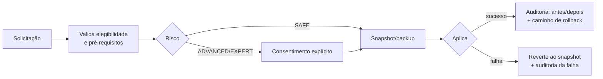

# SECURITY — NEXUS OPTIMIZER

**Estado: 📝 Planejado**

Políticas de segurança, permissões, backups, auditoria e reversibilidade. Este documento é **normativo**: qualquer código que viole estas regras é bug de arquitetura, não de implementação.

## 1. Modelo de privilégio mínimo

| Princípio | Regra |
|---|---|
| Processo principal | `Nexus.App` executa **sempre sem elevação**. Se o usuário iniciar "como administrador", o app avisa e recomenda reiniciar sem elevação. |
| Operações privilegiadas | Somente via `Nexus.Elevated.exe`, processo separado, spawn sob demanda (1 UAC por sessão), encerra quando ocioso. |
| Whitelist | A lista de operações permitidas no helper é **compilada no binário**, não lida de configuração em runtime. |
| Payload IPC | Nome de operação + parâmetros tipados e validados. **Nunca** comando shell livre, script ou caminho arbitrário de executável. |
| Canal | Named pipe local, ACL restrita ao usuário atual; helper valida que o cliente é o `Nexus.App` esperado (PID + identidade do processo). |
| UAC negado | Operação aborta limpa: nenhum estado parcial é aplicado e a auditoria registra `CANCELADO_USUARIO`. |

## 2. Classificação de risco dos tweaks

| Nível | Definição | Exigências |
|---|---|---|
| **SAFE** | Reversível instantaneamente, sem risco conhecido de perda de dados ou boot | Snapshot + auditoria |
| **ADVANCED** | Afeta comportamento do sistema de forma perceptível (serviços, energia, rede) | Tudo de SAFE + consentimento explícito com texto claro do que muda |
| **EXPERT** | Pode exigir conhecimento para diagnosticar efeitos colaterais | Tudo de ADVANCED + aviso de risco destacado + confirmação por digitação ou equivalente |
| **BLOQUEADO** | Nunca oferecido pelo app | Não existe caminho de UI que chegue nele |

### 2.1 Lista bloqueada por padrão (RF-OPT-05)

Não configurar, não desativar, não inspecionar:

- Microsoft Defender (qualquer componente)
- Windows Update / serviços de atualização
- Windows Firewall
- Anti-cheat de jogos (não inspecionar, não burlar, não tocar)
- BIOS, overclock, undervolt do usuário (somente leitura informativa)
- Credenciais, tokens, chaves, cofres do sistema

## 3. Regras de mutação (portão único)

Toda mutação passa por `IMutationExecutor`, sem exceção. O fluxo obrigatório:

1. **Snapshot antes de aplicar** — export `.reg` por chave para registro; backup de valor/configuração para serviços e powercfg; ponto de restauração do sistema antes de qualquer **lote** de mutações.
2. **Backup granular por operação** (RF-SEC-02): cada chave de registro exportada individualmente em `.reg`, nomeado com timestamp + ID da mutação, armazenado em local registrado na tabela `registry_backups`.
3. **Auditoria obrigatória**: toda mutação gera linha na tabela `mutations` com: ID, tweak, nível, timestamp, valor anterior (ou evidência de ausência), valor novo, método de rollback, status.
4. **Rollback por item** (RF-SEC-03) e **assistente "reverter tudo"** (RF-SEC-04) baseados exclusivamente na trilha de auditoria — nunca em heurística.

## 4. Critérios de classificação de órfãos de registro (RF-DIAG-05)

Regra derivada de incidente real: **"pasta ausente" não prova desinstalação.** Uma entrada de uninstall só pode ser classificada `ORFAO_PROVAVEL` se satisfizer **critérios múltiplos**:

| Critério | Peso |
|---|---|
| `InstallLocation` aponta para pasta inexistente | 1 |
| `UninstallString`/`DisplayIcon` aponta para arquivo inexistente | 1 |
| Ausência de qualquer arquivo do produto no disco | 1 |
| Editor (`Publisher`) sem nenhum outro produto instalado | 0,5 |

Classificação mínima para propor remoção: **≥ 2,5 pontos**, com visualização dos critérios atendidos antes de qualquer ação. Classes `SISTEMA` (Windows, drivers, runtimes Microsoft) e `MSI` com produto presente **nunca** entram na lista de candidatos. Remoção somente com export `.reg` individual por chave e confirmação por item ou lote explícito.

## 5. Limpeza de disco (RF-CLN)

| Regra | Detalhe |
|---|---|
| Dry-run obrigatório | Toda categoria é simulada com tamanho e classificação antes de qualquer exclusão. |
| Fase 1 permitida | Temp do usuário, caches de GPU (ex.: DXCache), lixeira, logs rotativos, `DISM StartComponentCleanup` (via helper elevado). |
| Proibido | Deleção automática de registro ver §4; nada em pastas de perfil de outros usuários; nada em `Program Files`; nada em `WinSxS` fora do DISM oficial. |
| Caminho resolvido | Todos os alvos são resolvidos contra listas internas — nunca de entrada de texto livre do usuário sem validação de escopo. |

## 6. Dados e privacidade

- **Nenhum dado sai da máquina** (RNF-05): sem telemetria remota, sem analytics, sem chamadas de rede do app principal.
- Logs locais em `%LocalAppData%\Nexus\logs` (Serilog rolling file) com retenção limitada e configurável.
- Logs **nunca** contêm credenciais, tokens, chaves, conteúdo de arquivos do usuário ou dados pessoais além do estritamente operacional (nomes de processos, caminhos de sistema).
- Banco SQLite local, sem criptografia obrigatória na fase 1 (conteúdo não sensível: diagnósticos, medições, auditoria).
- `.gitignore` do repositório bloqueia: `*.env`, `secrets*.json`, `appsettings.*.Local.json`, `*.pfx/*.key/*.pem`, `*credentials*`, dumps de hardware e backups `.reg`.

## 7. Auditoria e trilha de reversão

Tabela `mutations` é a fonte da verdade. A tela **Security & Restore** lista 100% das mutações feitas pelo app (critério de aceitação global 3), com:

- linha do tempo filtrável (por módulo, nível de risco, período);
- estado antes/depois por item;
- botão de rollback individual;
- exportação da trilha (JSON) para o usuário.

Rollback nunca depende de estado externo volátil: se o backup necessário sumiu (ex.: `.reg` apagado manualmente), a UI informa o impeditivo com o caminho esperado — não executa rollback cego.

## 8. Superfície de ataque considerada

| Vetor | Mitigação |
|---|---|
| Helper elevado abusado por outro processo | ACL do named pipe + validação de identidade do cliente + whitelist compilada |
| Parâmetros maliciosos via IPC | Parâmetros tipados, validação de domínio no helper (ex.: nome de serviço ∈ whitelist) |
| `.reg` de rollback adulterado | Backups em pasta controlada pelo app; hash armazenado na auditoria |
| Execução elevada sem consentimento | UAC nativo do Windows: o helper só sobe com consentimento do usuário na caixa do sistema |
| Logs como vazamento | Conteúdo de log restrito a dados operacionais (ver §6) |

## 9. Referências

- Microsoft — [UAC (User Account Control)](https://learn.microsoft.com/windows/security/application-security/application-control/user-account-control/)
- Microsoft — [Named pipes e segurança](https://learn.microsoft.com/windows/win32/ipc/named-pipe-security-and-access-rights)
- Microsoft — [System Restore (SRSetRestorePoint)](https://learn.microsoft.com/windows/win32/sr/srsetrestorepoint)
- Microsoft — [DISM StartComponentCleanup](https://learn.microsoft.com/windows-hardware/manufacture/desktop/clean-up-the-winsxs-folder)
